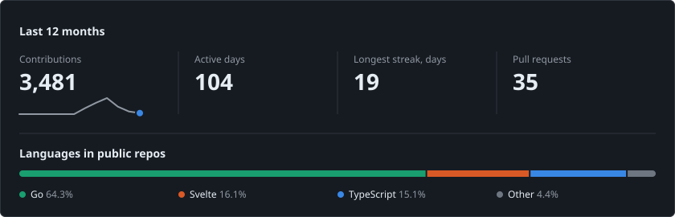

## Stack

**Languages**    

**ML and signal processing**     

**Edge inference**  

**Desktop and web**     

**Environment**     

## Tools

Go + Wails + Svelte. Builds are on each repo's Releases page.

<table>
<tr>
<td width="50%" valign="top">

<a href="https://github.com/hoijunkim/fleet"><b>fleet</b></a> · Windows, macOS, Linux 
Dashboard for every git repo under your project roots. See what is dirty or behind, then fetch, commit, resolve conflicts and search across all of them.

</td>
<td width="50%" valign="top">

<a href="https://github.com/hoijunkim/shape"><b>shape</b></a> · Windows, macOS, Linux 
Browse JSON, NDJSON, CSV, TSV, Parquet and SQLite files as a table. Filters show the equivalent jq and SQL. Also ships as a CLI profiler.

</td>
</tr>
<tr>
<td width="50%" valign="top">

<a href="https://github.com/hoijunkim/gifly"><b>gifly</b></a> · Windows 
Video or images to GIF, WebP or APNG, with a live size estimate.

</td>
<td width="50%" valign="top">

<a href="https://github.com/hoijunkim/flip"><b>flip</b></a> · Windows 
Captures a screen region page by page, then exports images or a PDF.

</td>
</tr>
</table>

## Research

- PhD thesis: automatic EMG labeling from video motion, for prosthetic-hand control. Defense in 2026.
- [RNNsignal](https://github.com/hoijunkim/RNNsignal): EMG classifiers in PyTorch. A GRU stack labels every timestep; an LSTM variant labels whole windows.
- On-device inference on the Intel Lunar Lake NPU with OpenVINO.

## Writing

<!-- writing:start -->
- `2026-01-30` [Shallow stacks use the whole bound](https://hoijunkim.github.io/blog/en/shallow-stacks-use-it-all/)
- `2026-01-24` [Stacking layers added nothing](https://hoijunkim.github.io/blog/en/stacking-layers-added-nothing/)
- `2026-01-18` [Where it starts failing](https://hoijunkim.github.io/blog/en/where-it-starts-failing/)
- `2026-01-12` [Changing the task inverted the order](https://hoijunkim.github.io/blog/en/changing-the-task-inverted-it/)
- `2026-01-06` [Comparing by steps favoured the transformer](https://hoijunkim.github.io/blog/en/steps-favoured-the-transformer/)
<!-- writing:end -->

[All posts](https://hoijunkim.github.io/blog/)

## Stats

